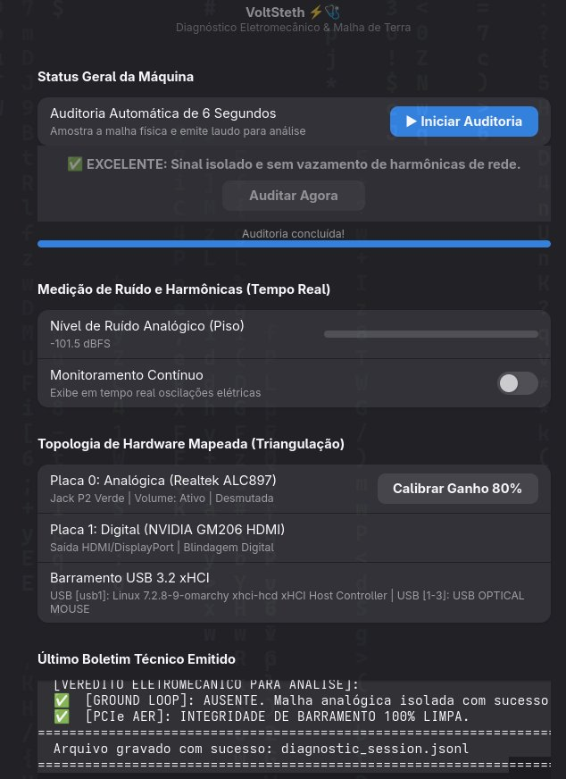

# VoltSteth ⚡🩺

[](https://en.wikipedia.org/wiki/C%2B%2B20)
[](https://gnome.pages.gitlab.gnome.org/libadwaita/)
[](LICENSE)
[](https://kernel.org)
[]()

> **O estetoscópio elétrico e físico de baixo nível para Linux.**  
> Interface gráfica nativa (GTK4/Libadwaita) e CLI de alta performance para detectar loops de terra (*ground loops*), ruído de interferência eletromagnética (EMI/coil whine), oscilações de voltagem (VRM ripple) e integridade de barramento físico com mapeamento de topologia.

---

## 🖥️ Interface Gráfica (UI/UX para Usuário Comum)

<p align="center">
  
</p>

Para quem não quer lidar com o terminal, o **VoltSteth** conta com uma interface gráfica moderna e responsiva em **GTK4 + Libadwaita** (com suporte nativo ao Wayland / Hyprland):

* **Medidor com Balística & Peak-Hold:** VU meter com decaimento suave que segura os picos visuais, tornando a leitura humanamente perceptível.
* **Mapeamento Visual de Topologia:** Exibe as placas de áudio físicas (Analógica vs Digital HDMI da GPU) e os dispositivos conectados no controlador USB 3.2 xHCI.
* **Calibração com 1 Clique:** Botão para desmutar e ajustar o ganho analógico a 80%, eliminando o risco de falsos negativos por microfone mutado no mixer do sistema operacional.
* **Auditoria Automatizada:** Botão de 1 clique que roda a análise física por 6 segundos e exibe um laudo técnico formatado com veredito direto.

---

## 🛠️ O que o VoltSteth Detecta?

1. **Loop de Terra (Mains Hum):**
   * Processa o sinal via **algoritmo de Goertzel com janela de Hann** (eliminando vazamento espectral), caçando as frequências fundamentais e harmônicas da rede elétrica local ($60\text{ Hz}$, $120\text{ Hz}$, $180\text{ Hz}$ no Brasil/EUA ou $50\text{ Hz}$ na Europa).
   * Alerta imediatamente se o sinal de 60Hz/120Hz sobressair com significância matemática acima do piso de ruído do ambiente.
2. **Triangulação Topológica e Pre-Flight Check:**
   * Mapeia a árvore de conexões de hardware (Controladores PCI, placas ALSA e barramento USB).
   * Audita os registradores do chip de áudio (Realtek ALC897) e recusa falso negativo se o canal de captura estiver mutado no mixer.
3. **Ripple e Instabilidade de VRM / Fonte:**
   * Amostra os sensores de voltagem do subsistema de kernel `/sys/class/hwmon` e calcula o desvio padrão ($\sigma$) e a tensão pico-a-pico ($V_{\text{pp}}$) em janelas móveis temporais.
4. **Acoplamento Eletromagnético (EMI & Coil Whine):**
   * Calcula o **coeficiente de correlação de Pearson** entre picos de ruído de alta frequência (2 kHz a 12 kHz) e pulsos de potência instantânea da CPU/GPU (via Intel RAPL / microjoules).
5. **Erros de Barramento PCIe (AER):**
   * Monitora em tempo real os contadores do protocolo PCIe AER (Advanced Error Reporting) para falhas físicas na trilha do slot ou mau contato.

---

## 🏗️ Arquitetura de Software (Pipe-and-Filter)

```
[ Data Sources ]               [ Filter Chain ]                     [ Sinks ]
┌──────────────────┐           ┌────────────────────────────┐       ┌─────────────────┐
│ AlsaAudioSource  │──────┐    │ GroundLoopDetector         │   ┌──>│  ConsoleHudSink │
└──────────────────┘      │    └────────────────────────────┘   │   └─────────────────┘
┌──────────────────┐      ├───>┌────────────────────────────┐───┤   ┌─────────────────┐
│ HwmonPowerSource │──────┼───>│ VoltageRippleDetector      │───┼──>│  JsonStreamSink │
└──────────────────┘      │    └────────────────────────────┘   │   └─────────────────┘
┌──────────────────┐      │    ┌────────────────────────────┐   │   ┌─────────────────┐
│  PcieAerSource   │──────┼───>│ EmiCorrelationDetector     │   └──>│ SessionRecorder │
└──────────────────┘      │    └────────────────────────────┘       └─────────────────┘
┌──────────────────┐      │
│ TopologySource   │──────┘
└──────────────────┘
```

---

## 🚀 Como Executar

### 1. Interface Gráfica (Recomendado):
Abra pelo menu de aplicativos do seu sistema procurando por **VoltSteth**, ou rode diretamente pelo terminal:
```bash
./gui/volt_steth_gui.py
```

### 2. Mapeamento de Topologia Física (CLI):
```bash
./build/volt-steth --topology
```

### 3. Executar Auditoria Automática (Gera laudo em 6 segundos):
```bash
./build/volt-steth --config config.default.ini --diagnose
```

### 4. Gravar Sessão de Telemetria Contínua (para análise por IA):
```bash
./build/volt-steth --config config.default.ini --record sessao.jsonl --duration 30
```

### 5. Executar a HUD Interativa no Terminal:
```bash
./build/volt-steth --config config.default.ini
```

---

## 📦 Compilação e Instalação

### Pré-requisitos (Arch / Omarchy Linux):
```bash
sudo pacman -S base-devel cmake alsa-lib python-gobject libadwaita
```

### Compilar o Core C++20:
```bash
cmake -B build
cmake --build build
```

### Executar a Suíte de Testes Automatizados:
```bash
./build/test-pipeline
```

---

## 📄 Licença
Distribuído sob a licença [MIT](LICENSE).
